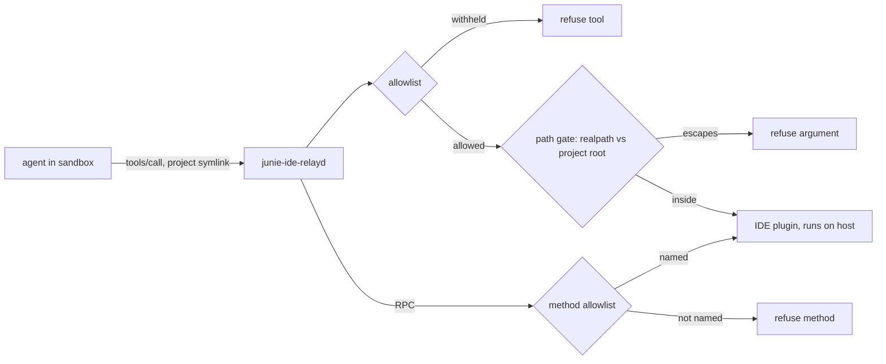

# Requirements

### Overview & Goals

Close the findings from the non-destructive review of the `junie-sbx-junie` sandbox at `e17329e`. Three of them are critical and share one root cause: **the IDE's project-containment check is lexical, so a symlink the agent creates in the project resolves on the host**. The sandbox cannot fix this — `realpath` inside it resolves to a path that does not exist — so the gate goes in the host daemon `bin/junie-ide-relayd`, which resolves symlinks exactly as the IDE will.

Today, with no withheld tool, the agent can read the host's `~/.ssh`, read every project's relay secret, and forge the operator's mount-approval record.

### Scope

#### In Scope

- **F1 — Host read/write escape.** A project symlink (`ln -s ~/.ssh .p-ssh`) makes `read_file`, `list_directory_tree`, `create_new_file` and `apply_patch` operate on the host. Proven: `read_file <project>/.p-ssh/id_ed25519` returned a complete private key; `/etc/hostname` read through the link returned the host's name (`Jenna3`) where the sandbox's is `localhost.localdomain`.
- **F2 — Cross-project secret disclosure.** The same link reaches `~/.config/junie-sbx/relay-secrets`; a disclosed `coffee-cards` secret answered `mcp-port 64562` for that project's digest.
- **F3 — Forged mount approval.** The same link reaches `mount-approvals`; a record written by the agent made `junie-sbx.sh` mount an outside path with exit 0 and no operator approval (proven against a throwaway home with a stub `sbx`).
- **F4 — The overlay fallback is not verified before use.** `merge_overlay` makes the merged directory whether or not a mount follows, and checks neither mechanism's result, so a merge that did not happen is mounted and used exactly like one that did: the sandbox is handed a writable path that is the lower tree in place, or a plain directory. A defect in the code; the failure was **not** observed here — on this host `upper` and `work` exist and `merged` is a distinct overlay mount. Measuring it from inside a sandbox cannot settle it, because there the merged paths are `sbx`-provided virtiofs shares and the state directory is the container's own root.
- **F5 — RPC relay is unfiltered** while the MCP relay is filtered.
- **F6 — The `~/.junie` view is too wide**: other projects' transcripts and `history.jsonl` are readable.
- **F7 — `execute_tool` is checked on its first word**, which cannot say which tool and arguments are allowed.

#### Out of Scope

- The host `sbx` runtime's own egress policy, its `localhost` narrowing, and its SSH-agent setting. `sbx` is absent from this image, so these were measured as the arguments this repo produces rather than as completed mounts.
- Replacing the IDE plugin's path handling: the plugin is not this repo's code. The daemon gates the calls instead.
- A deploy key for a pushing sandbox (the open half of the prior review's priority 1). It needs a host-side decision about which key, and is not a code change here.

### Functional Requirements

- **FR1.** A `tools/call` whose path argument resolves outside the project root is refused by the daemon, and the IDE is never asked to run it. Refusal is a `tools/call` error, in the same shape as the existing tool refusal, so the CLI reports it rather than hanging.
- **FR2.** The gate resolves paths the way the IDE does: `realpath` on the host, against the project root the daemon already resolves via `project_for_digest`. In-project symlinks (`node_modules/.bin`) keep working.
- **FR3.** `apply_patch` is gated on the paths in its patch body, not only on `projectPath`.
- **FR4.** Only allowlisted methods reach the plugin over the RPC relay; anything else is answered by the daemon.
- **FR5.** When `merge_overlay` cannot make an overlay, the host tree is mounted **read-only** and the operator is warned. It is never mounted read-write, and the run continues.
- **FR6.** The `~/.junie` view exposes `AGENTS.md`, `docs/`, `tools/` and this project's sessions only.
- **FR7.** `execute_tool` is checked on the dispatched tool name *and* its arguments, not on a command-line prefix.

### Non-Functional Requirements

- Every refusal is fail-closed: an unreadable body, an unparseable path or an unresolvable project root refuses the call rather than forwarding it.
- No new dependency; stdlib only, matching the rest of the daemon.
- The existing 89 tests keep passing; the suite runs 130 at the end.


# Technical Design

### Current Implementation

`bin/junie-ide-relayd` is the host half of the relay. `handle` reads a one-line preamble, `authenticate` binds the digest to the project's provisioned secret, and the payload prefix selects a splice:

- `relay_rpc` → `splice_to` → `splice`, a byte splice, unfiltered (line 1647).
- `relay_mcp` → `splice_mcp`, which frames both directions as HTTP and removes any tool outside `allow` from `tools/list` and `tools/call` (`refused_tool`, line 998; `scrub_payload`, line 1041).
- `relay_pair` → `splice`.

`splice_mcp` is therefore already the one place that parses a tool call on the host, with `read_message`/`tool_calls` (lines 1249, 1267) doing the decoding and `first_refusal` (line 1380) deciding. That is where the path gate belongs: it has the parsed arguments, and it runs as the host user, so `os.path.realpath` resolves the link the IDE will follow.

`project_for_digest` (line 448) already returns the project root for a digest, and `authorized` (line 586) already uses `realpath` containment in exactly the form the gate needs.

### Key Decisions

**D1 — Gate in the daemon, not in the sandbox.** The sandbox's `realpath` cannot see the target of `~/.ssh`, so a sandbox-side check would have to guess. The daemon resolves the same way the IDE does. This also covers a second IDE that opens the project later, since the gate is per-call.

**D2 — Per-tool parameter map (chosen).** A table names the path-bearing parameters; each is resolved and checked against the project root. This leaves in-project symlinks working, which a blanket symlink-component refusal would break.

**D3 — `apply_patch` is gated on its patch body.** Its only declared path is `projectPath`, so a gate that trusted the schema would pass a patch that adds `../../.ssh/authorized_keys`. The patch's `*** Add/Update/Delete File:` headers are parsed and each path resolved.

**D4 — RPC allowlist is default-deny, scoped by risk (chosen by the operator).** The plugin's `initialize` advertises 15 services with 51 methods between them, not the one method the daemon itself calls, and the CLI drives most of them. The allowlist names the methods that mutate the project or name a path, plus the `initialize` handshake the CLI opens every connection with; the rest are answered by the daemon. `JunieEditService.applyPatch` is the one that matters most: it is a write path that bypasses both the tool allowlist and the path gate, so the allowlist is what closes it. `initialize` is not optional — refusing it breaks the connection rather than narrowing it.

**D5 — No overlay means a read-only mount (chosen by the operator).** `merge_overlay` verifies an overlay is really in force before the path is mounted read-write; if it is not, the mount is read-only and a warning is printed. `UV_CACHE_DIR` and friends then point at a read-only tree, so a cold write fails visibly instead of landing wherever the merged path actually points.

**D6 — The session view links index-mapped sessions only (chosen by the operator).** A session directory is linked when `index.jsonl` maps its `sessionId` to this project's `projectDir`, and nothing else is linked. The measured view is 89 directories: 1 this project's, 17 known to be other projects', and 71 with no index entry. A fail-safe that kept the unindexed ones would link 72 of 89 and leave the leak, so it is not used.

### Data Models / Contracts

```python
# Per-tool path-bearing arguments. A value is a parameter name, or a dotted
# name for a nested one. `paths` is a list of strings.
TOOL_PATH_ARGS = {
    "read_file": ("file_path",),
    "create_new_file": ("pathInProject",),
    "list_directory_tree": ("directoryPath",),
    "open_file_in_editor": ("filePath",),
    "get_file_problems": ("filePath",),
    "get_symbol_info": ("filePath",),
    "get_python_environment": ("filePath",),
    "get_run_configurations": ("filePath",),
    "analyze_calls": ("treePath",),
    "search_file": ("paths",), "search_regex": ("paths",),
    "search_symbol": ("paths",), "search_text": ("paths",),
    "rename_refactoring": ("pathInProject",),
    "create_notebook": ("file_path",), "read_notebook": ("file_path",),
    "read_notebook_cell": ("file_path",), "edit_notebook": ("file_path",),
    "get_notebook_state": ("file_path",),
    "git_status": ("repositoryPathRelativeToProject",),
}
# apply_patch is handled separately: its paths live in its `input`/`patch` body.


def escapes(path, root):
    """Whether `path`, resolved, leaves `root`. Relative paths resolve against `root`."""

def refused_path(params, tool, root):
    """The argument a call reaches outside `root`, or None to forward it."""

# RPC methods the plugin may be asked for.
DEFAULT_ALLOW_RPC = ("JunieMcpService.getBuiltInMcpServerCredentials",)
```

Refusal shape, matching `refused_reply` (line 1374) so the CLI reports it as it reports a withheld tool:

```json
{"jsonrpc":"2.0","id":7,"error":{"code":-32602,
 "message":"Argument 'file_path' resolves outside the project"}}
```

### Proposed Changes

**`bin/junie-ide-relayd`**

- Add `TOOL_PATH_ARGS`, `escapes`, `patch_paths` and `refused_path` beside `refused_tool` (line 998), and extend `refused_tool`'s caller rather than replacing it: `first_refusal` (line 1380) checks the tool name first, then the path arguments. The gate is skipped when the project root is `None`, which is the `gone` case already handled.
- Parse the patch body in `apply_patch` calls: `*** Add File:`, `*** Update File:`, `*** Delete File:`, and the `--- a/…` / `+++ b/…` unified-diff form.
- Add `DEFAULT_ALLOW_RPC` and a filtered `relay_rpc` that reuses `splice_mcp`'s framing with a method predicate instead of a tool predicate. Factor the shared HTTP framing so the two splices do not diverge; the existing `HttpConnection`, `read_body_or_lull`, `framing_conflict` and `strip_accept_encoding` are reused as-is.
- Report both gates at startup, as `report_allow` (line 314) does for the tool list.

**`junie-sbx.sh`**

- `merge_overlay` (line 313) verifies before use: `upper`/`work` exist and the merged path is its own mount with `upperdir=` in `/proc/self/mountinfo`. On failure it mounts the lower tree with `:ro` intent and warns. Since a failed overlay must not be mounted read-write by `sbx`, the mount entry is added with the `:ro` marker.
- `init_junie_home` (line 275) links only this project's session directories: filter `sessions/session-*` by `projectDir` from `index.jsonl` instead of linking every one.
- `provision_relay_secret` (line 245) writes `project_path` already; no change needed there. `read_config_file` needs no change: the approval record is written by `record` only, and with the gate in place the agent can no longer put one there.

**`kit/spec.yaml`** — no change. The `mounts` for the cache trees are produced by the script, which is where the read-only decision belongs.

### File Structure

Modified only:

```
bin/junie-ide-relayd      path gate, apply_patch parsing, RPC allowlist
junie-sbx.sh              overlay verification, session-view narrowing
tests/test_relayd.py      gate and RPC cases
tests/test_sbx_mounts.py  approval-forgery case, overlay case
kit/README.md            "MCP tools" gains the path gate; new "RPC methods"
docs/review.md            the open read_* question is answered
```

### Architecture Diagram



The gate sits between the allowlist and the IDE, so neither a withheld tool nor an escaping argument reaches the plugin.

### Risks

- **A narrow map misses a tool.** A tool whose path parameter is not in `TOOL_PATH_ARGS` passes ungated. Mitigation: the map is keyed on the live `tools/list` surface (44 tools, 41 with path parameters), and a test asserts every tool whose schema has a path-like parameter appears in the map or is explicitly exempt, so a new IDE tool fails the test rather than the gate.
- **`apply_patch` formats vary.** Only the two forms the plugin documents are parsed; an unparseable body is refused rather than forwarded, which is fail-closed but could refuse a legitimate patch. Mitigation: a test drives both forms, and the refusal names the reason.
- **Read-only cache mounts change behaviour.** A cold `uv` or `pnpm` write now fails instead of silently writing where the merge did not land. That is the intent where the overlay is absent, but it surfaces as a build error and costs cache reuse on a host whose merge works. Mitigation: the check tests the outcome rather than the mechanism, so a host with a working overlay is unaffected; the warning names `fuse-overlayfs` as the fix.
- **Session filtering drops a session.** Matching on `projectDir` relies on `index.jsonl` being current, so a session it does not map stops being reachable even if it belongs to this project. That is the operator's chosen trade (D6): the alternative left 71 of 89 directories linked, which does not close the leak.


# Testing

### Validation Approach

The suites are unit-level and run without a host IDE: `tests/test_relayd.py` drives `splice_mcp` over `socket.socketpair()` with a fake IDE (`SpliceSession`), and `tests/test_sbx_mounts.py` drives `junie-sbx.sh` against a stub `sbx` that records its argv. Both patterns extend directly.

```
python3 -B -m unittest discover -s tests
python3 ~/.junie/tools/check_doc_prose.py
```

### Key Scenarios

Path gate, over `SpliceSession` with a `tmpdir` project root containing a real symlink to a sibling directory:

- `read_file` with `file_path` under the project → forwarded to the IDE.
- `read_file` with `file_path` naming the project symlink → **refused**, IDE silent (`ide_is_silent`).
- `read_file` with `file_path` as a plain outside path → refused.
- `read_file` with `file_path` as `../../etc/passwd` → refused.
- An in-project symlink whose target is also in the project → forwarded.
- `apply_patch` whose body adds `*** Add File: ../escape` → refused; whose body adds a file inside the project → forwarded.
- A batch with one escaping call → held back whole, as `first_refusal` already does for a withheld tool.
- A tool absent from `TOOL_PATH_ARGS` with a path argument → forwarded, and the coverage test is what catches the omission.

RPC allowlist:

- `JunieMcpService.getBuiltInMcpServerCredentials` → forwarded.
- `JunieUnknownService.noSuchMethod` → answered by the daemon with `-32601`, IDE silent.

Mount approval (`test_sbx_mounts.py`):

- An approval record present but written by anything other than `record` is still read — the script cannot tell. The new defence is the gate, so the case here is: the existing `test_the_host_root_is_refused_because_it_holds_the_relay_secrets` and `test_relay_secrets_is_refused_even_when_approved` keep passing, plus a case that a record for a second project's digest does not approve this one.

Overlay:

- With a stubbed `fuse-overlayfs` that exits 0 without mounting, the mount passed to `sbx` carries the `:ro` marker.
- With no `upper` directory, likewise.

Session view:

- Two sessions in `index.jsonl`, one with this project's `projectDir` and one with another's: only this project's link is made; the other is absent.

### Edge Cases

- A `file_path` that does not exist yet (`create_new_file`): the parent is resolved, the leaf is not, so creation inside the project still works and creation through a symlinked parent is refused.
- A path with a trailing separator, a `.` segment, or a doubled separator.
- An empty or non-string `paths` member in a `search_*` call.
- A patch touching two files where only one escapes → refused whole, matching the batch decision.
- The project root resolving to a path that no longer exists (digest names a closed IDE) → gate skipped, as today.

### Test Changes

- `tests/test_relayd.py`: a `PathGateTest` class over `SpliceSession`, a `ToolCoverageTest` asserting every path-bearing tool in a pinned copy of the `tools/list` schema is mapped or exempt, and an `RpcAllowTest` over the new splice.
- `tests/test_sbx_mounts.py`: an overlay case and a cross-project-approval case.
- `tests/test_endpoint.py`, `tests/test_splice.py`, `tests/test_tty_filter.py`: unchanged.


# Delivery Steps

### ✓ Step 1: Gate tool path arguments in the relay daemon
A `tools/call` whose path argument resolves outside the project is refused by the daemon, so the IDE never runs it.

- Add `TOOL_PATH_ARGS`, `escapes()` and `refused_path()` to `bin/junie-ide-relayd` beside `refused_tool` (line 998), resolving each path with `os.path.realpath` against the root from `project_for_digest` (line 448).
- Treat a relative argument as relative to the project root; resolve the parent of a not-yet-existing path so `create_new_file` still works inside the project.
- Extend `first_refusal` (line 1380) to check the tool name and then the path arguments, keeping the existing `-32601` shape for a withheld tool and adding a `-32602` shape for an argument.
- Skip the gate when the project root is `None` (the `gone` case already handled by `relay_mcp`).
- Add a case per tool shape and per escape shape in `tests/test_relayd.py` over `SpliceSession`, including that the IDE is sent nothing on a refusal.

### ✓ Step 2: Gate apply_patch on the paths inside its patch body
An `apply_patch` call whose body touches a path outside the project is refused, closing the case its schema alone cannot show.

- Add `patch_paths()` to `bin/junie-ide-relayd`, parsing `*** Add File:`, `*** Update File:`, `*** Delete File:` and the unified-diff `--- a/…` / `+++ b/…` form.
- Route every parsed path through the same `refused_path` check, so one escaping file in a multi-file patch refuses the whole call, matching how a batch is already held back.
- Refuse rather than forward a body the parser cannot read, and name the reason in the reply.
- Cover both patch forms and the multi-file case in `tests/test_relayd.py`.

### ✓ Step 3: Filter the RPC relay with a method allowlist
Only allowlisted RPC methods reach the IDE plugin; every other method is answered by the daemon.

- Add `DEFAULT_ALLOW_RPC` (currently only `JunieMcpService.getBuiltInMcpServerCredentials`) to `bin/junie-ide-relayd`, in the same idiom as `DEFAULT_ALLOW_TOOLS` (line 176).
- Factor the HTTP framing out of `splice_mcp` so a method predicate and a tool predicate share `HttpConnection`, `read_body_or_lull`, `framing_conflict` and `strip_accept_encoding` rather than diverging.
- Rewrite `relay_rpc` (line 1647) to use the filtered splice; an unnamed method gets `-32601` and is not forwarded.
- Report the RPC list at startup beside the tool list, as `report_allow` (line 314) does.
- Cover forwarded and refused methods in `tests/test_relayd.py`.

### ✓ Step 4: Verify the overlay before mounting a cache tree writable
When the merge is not really an overlay, the tree is mounted read-only and the operator is warned, so a writable path is never handed out over a lower tree in place.

- Verify in `merge_overlay` (`junie-sbx.sh` line 313) that an overlay is really in force: `upper` and `work` exist and the merged path is its own mount with `upperdir=` in `/proc/self/mountinfo`.
- On failure, mount the lower tree with the `:ro` marker and print a warning naming `fuse-overlayfs` as the fix; never mount it read-write.
- Keep the run going rather than aborting, so a cold `uv`/`pnpm` write fails visibly instead of silently writing somewhere unexpected.
- Add cases to `tests/test_sbx_mounts.py`: a `fuse-overlayfs` stub that exits 0 without mounting, and a missing `upper` directory — both must produce a `:ro` mount argument.

### ✓ Step 5: Narrow the ~/.junie view to this project's sessions
The sandbox sees `AGENTS.md`, `docs/`, `tools/` and only this project's sessions, instead of every project's transcripts.

- Filter the `sessions/session-*` loop in `init_junie_home` (`junie-sbx.sh` line 297) by the `projectDir` field in `index.jsonl` (`session-history` shape: `{"sessionId","projectDir",…}`).
- Leave a session with no index entry alone rather than dropping it, so the failure mode is linking too much rather than too little.
- Add a case to `tests/test_sbx_mounts.py` with two index entries, asserting only this project's link is made.

### ✓ Step 6: Document the gates and close the review's open question
The relay's README and the two review documents describe the gates that now exist, and the question `docs/review.md` left open is answered.

- Add an "RPC methods" section to `kit/README.md` beside "MCP tools", and extend that section with the path gate and the `apply_patch` rule.
- In `docs/review.md`, replace the open `read_*` question (line 669) with the measured answer and the gate that closes it.
- In `docs/sandbox_review.md`, mark priorities 4, 5 and 6 resolved and record the three critical findings with their reproductions.
- Note the read-only cache fallback where `merge_overlay` is described.
- Run `python3 ~/.junie/tools/check_doc_prose.py` and fix its hits, then `python3 -B -m unittest discover -s tests`.